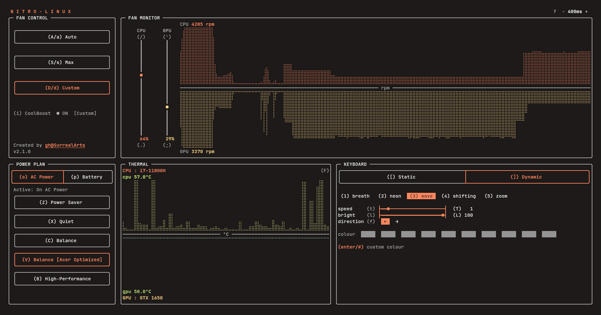

# nitro-linux

Kernel driver, daemon, and btop-style TUI for Acer Nitro laptops: keyboard backlight effects, fan monitoring, thermal policies. On verified models it coexists with in-tree `acer-wmi`; other models may be supported through the probe interface. See [Models](docs/MODELS.md) and [Contributing](docs/CONTRIBUTING.md).

Minimum terminal size: **120x47**



## Documentation

- [Supported models & how to report](docs/MODELS.md)
- [Contributing a model report](docs/CONTRIBUTING.md)
- [Reverse-engineering notes](docs/REVERSE.md)

## Install

### Package

```ini
[nitro-linux]
SigLevel = Required DatabaseOptional
Server = https://surrealarts.github.io/nitro-linux/$arch
```

```bash
sudo pacman-key --keyserver hkps://keyserver.ubuntu.com --recv-keys 7EA2338784E083123CC077F2E29A80B4FDD576B1
sudo pacman-key --lsign-key 7EA2338784E083123CC077F2E29A80B4FDD576B1
```

Install the headers for your running kernel (`linux-headers` or `linux-lts-headers`), then:

```bash
sudo pacman -Syu nitro-linux
```

Reboot once. `/etc/nitro.conf` is created only if absent. Updates are normal `pacman -Syu`.

```bash
sudo pacman -Rns nitro-linux
```

### Source

```bash
sudo bash deploy/install.sh
sudo bash deploy/uninstall.sh
```

## Use

`nitro-linux` opens the TUI. `nitro help` lists CLI commands, and `?` shows the in-app key map.

### TUI keys

| Area      | Keys                | Action                                                                     |
| --------- | ------------------- | -------------------------------------------------------------------------- |
| Fans      | `A` `S` `D`         | Auto, Max, Custom                                                          |
| Fans      | `.` `/`             | CPU duty -/+ 5%                                                            |
| Fans      | `;` `'`             | GPU duty -/+ 5%                                                            |
| CoolBoost | `i`                 | Toggle in Auto; disabled in Max/Custom                                     |
| Power     | `Z` `X` `C` `V` `B` | Power Saver, Quiet, Balance, Balance Acer, High-Performance                |
| Power     | `o` `p`             | AC / Battery tab                                                           |
| Thermal   | `F`                 | Switch °C / °F                                                             |
| Keyboard  | `[` `]`             | Static / dynamic mode                                                      |
| Keyboard  | `1`-`4`             | Select a static zone                                                       |
| Keyboard  | `x`                 | Toggle the selected static zone                                            |
| Keyboard  | `1`-`5`             | Dynamic effect: breath, neon, wave, shifting, zoom                         |
| Keyboard  | `t` `T`             | Dynamic speed -/+                                                          |
| Keyboard  | `f`                 | Dynamic direction (wave, shifting)                                         |
| Keyboard  | `#` or `Enter`      | Colour picker (static and colour effects)                                  |
| Keyboard  | `l` `L`             | Brightness -/+                                                             |
| Session   | `R`                 | Reapply saved state                                                        |
| Session   | `-` `+`             | Refresh interval; `-` faster, `+` slower                                   |
| Session   | `q` `Q`             | Quit UI (daemon continues running; stop with `sudo systemctl stop nitrod`) |

### CLI

| Command                                                              | Purpose                                                        |
| -------------------------------------------------------------------- | -------------------------------------------------------------- |
| `nitro` or `nitro status`                                            | Show fan, temperature, lighting, CoolBoost, and profile status |
| `sudo nitro rgb <zone> <r> <g> <b>`                                  | Set a static LED zone; zone is 1, 2, 4, or 8                   |
| `sudo nitro fan <cpu-or-gpu> <0-100>`                                | Set fan duty                                                   |
| `sudo nitro coolboost <on-or-off>`                                   | Toggle CoolBoost; fans must be Auto                            |
| `sudo nitro dyn <mode> <speed> <brightness> <direction> <r> <g> <b>` | Set dynamic lighting                                           |
| `sudo nitro profile <profile>`                                       | Set the platform profile                                       |
| `nitro key <command>`                                                | Bind or manage the NitroSense key                              |

Dynamic modes are `1` breath, `2` neon, `3` wave, `4` shifting, and `5` zoom. Speed is `0`-`255`, brightness is `0`-`100`, and direction is `1` or `2`. Profiles are `low-power`, `quiet`, `balanced`, `balanced-performance`, and `performance`. Writes go to root-owned sysfs, hence `sudo`.

### Nitro key

`nitro key <command>` binds the bare NitroSense key to a user command without changing udev mappings or desktop shortcut settings. No sudo required.

| Command                    | Purpose                                                                                              |
| -------------------------- | ---------------------------------------------------------------------------------------------------- |
| `nitro key auto`           | Capture the known Nitro key if needed, keep an existing command, and enable or restart the listener. |
| `nitro key find`           | Capture and save the next bare key press.                                                            |
| `nitro key status`         | Show the saved key, udev mapping, command, config path, and listener state.                          |
| `nitro key bind [command]` | Save a command and enable or restart the listener; the default opens `nitro-linux`.                  |
| `nitro key unbind`         | Remove the command and stop the listener.                                                            |
| `nitro key listen`         | Run the listener in the foreground, for systems without systemd user services.                       |

- **Trigger**: Only the bare key fires; Super, Alt, Ctrl, Shift, and Fn combinations are ignored.
- **Installer**: `nitro key auto --if-unconfigured` is the installer form; it does nothing when `~/.config/nitro/key.json` already exists.
- **Config**: Binding state is always `~/.config/nitro/key.json`, matching the TUI config, and is kept across upgrades and uninstalls.
- **Autostart**: `nitro-key.service` is the systemd user unit; without a running user manager, installers enable it for the next login; without systemd user services, `nitro key auto` or `nitro key bind` writes `~/.config/autostart/nitro-key.desktop`, and `nitro key listen` is the manual fallback.
- **Permissions**: Reading `/dev/input/event*` requires the `input` group: `sudo usermod -aG input "$USER"`, then log out and back in. The TUI talks to `nitrod` through `/run/nitro.sock`, which requires the `nitro` group: `sudo usermod -aG nitro "$USER"`, then log out and back in.
- **Install**: Package install, package upgrade, and source install run `nitro key auto --if-unconfigured` once for the invoking desktop user; an existing config is never rewritten. Otherwise run it yourself.
- **Conflicts**: `nitro key auto` never rewrites an existing command and does not modify udev rules or desktop shortcuts; if the desktop already uses this key, remove that shortcut and rerun.

### Persistent files and installed controls

#### Configuration and state

- `/etc/nitro.conf`: boot defaults for static/dynamic lighting, fan duty, CoolBoost, and platform profile; created only if absent and kept on uninstall; read by `nitro-apply` (`sudo systemctl restart nitro-apply` after edits); optional `coolboost on|off` applies only while both fans are Auto.
- `/etc/modules-load.d/nitro.conf`: loads the `nitro` kernel module at boot; removed on uninstall.
- `/var/lib/nitro/state.json`: daemon state for lighting, fan modes/duty, CoolBoost, and the `profile_ac`/`profile_battery` keys; kept on uninstall.
- `/var/lib/nitro/history.db`: 24-hour fan, temperature, and duty history written by `nitrod`; kept on uninstall.
- `~/.config/nitro/tui.json`: TUI refresh interval and °C/°F preference; kept on uninstall.
- `~/.config/nitro/key.json`: captured Nitro key and bound command; fixed at `~/.config` so the installer, CLI, and user service agree; kept across installs and uninstalls.
- `~/.config/autostart/nitro-key.desktop`: XDG fallback that starts `nitro key listen` at login when systemd user services are unavailable; removed on uninstall.
- `/run/nitro.sock`: runtime Unix socket for `nitrod`; owned `root:nitro` mode `660`; not persistent. Add your user with `sudo usermod -aG nitro "$USER"`, then log out and back in.

#### Services

- `nitro-apply.service`: oneshot boot service that runs `nitro-apply`; package `/usr/lib/systemd/system/nitro-apply.service`, source `/etc/systemd/system/nitro-apply.service`.
- `nitrod.service`: daemon that owns `/var/lib/nitro/state.json`, `/var/lib/nitro/history.db`, and `/run/nitro.sock`; package `/usr/lib/systemd/system/nitrod.service`, source `/etc/systemd/system/nitrod.service`.
- `nitro-key.service`: user listener started at login; package `/usr/lib/systemd/user/nitro-key.service`, source `/usr/local/lib/systemd/user/nitro-key.service`.
- `/etc/systemd/system/multi-user.target.wants/nitro-apply.service`, `/etc/systemd/system/multi-user.target.wants/nitrod.service`, and `~/.config/systemd/user/default.target.wants/nitro-key.service`: enablement symlinks created by `systemctl enable`; removed on uninstall.

#### Installed commands

- `nitro`: CLI; package `/usr/bin/nitro`, source `/usr/local/bin/nitro`.
- `nitro-linux`: TUI; package `/usr/bin/nitro-linux`, source `/usr/local/bin/nitro-linux`.
- `nitrod`: daemon; package `/usr/bin/nitrod`, source `/usr/local/bin/nitrod`.
- `nitro-apply`: applies `/etc/nitro.conf`; package `/usr/bin/nitro-apply`, source `/usr/local/bin/nitro-apply`.

#### Kernel, sensors, LEDs, and profiles

- `nitro` kernel module: `/usr/lib/modules/<kernel>/updates/dkms/nitro.ko.zst`; DKMS source `/usr/src/nitro-<version>/`, build state `/var/lib/dkms/nitro/<version>/`.
- `/sys/devices/platform/nitro/`: direct sysfs controls and readings, including `capabilities`, `fan_cpu`, `fan_gpu`, `fan_mode`, `coolboost`, `kbd_bright`, `kbd_static`, `kbd_dynamic`, `kbd_zone1`, `ec_cpu_temp`, `ftbl`, `tkst`, `opms`, and `wmi_raw`.
- `/sys/class/leds/nitro:rgb:zone*`: LED class devices for the four keyboard zones.
- `/sys/class/hwmon/hwmonX/`: `nitro-isa-0000` sensors (`fan1`, `fan2`, `temp1`) and `coretemp` package temperature when present.
- `/sys/class/platform-profile/platform-profile-0/profile`: platform profile; choices are `low-power`, `quiet`, `balanced`, `balanced-performance`, and `performance`.
- `/sys/class/power_supply/*/online`: AC/battery state that selects `profile_ac` or `profile_battery`.
- `/dev/input/by-path/platform-i8042-serio-0-event-kbd`: keyboard event device used by `nitro key`.

#### Package assets

- `/usr/share/nitro-linux/nitro.conf`: default config copied to `/etc/nitro.conf` only if absent.
- `/usr/share/licenses/nitro-linux/LICENSE`: package license.

## Secure Boot

Enroll the DKMS key once before installing:

```bash
sudo pacman -S mokutil
sudo mokutil --import /var/lib/dkms/mok.pub
```

If no keypair exists:

```bash
sudo openssl req -new -x509 -newkey rsa:2048 \
  -keyout /var/lib/dkms/mok.key -outform DER \
  -out /var/lib/dkms/mok.pub -nodes -days 36500 \
  -subj '/CN=DKMS module signing key/'
```

## Dependencies

Package: `python`, `dkms`, `systemd`, `acl` (for per-user socket access)

- optional: `nvidia-utils`

Source build: `linux-headers`, `dkms`, `make`, `gcc`, `sudo`

- secure boot: `mokutil` + `openssl`

Runtime: Python 3.9+ (tested on 3.9 and 3.13), `nvidia-smi` for GPU sensors

## Notes

- EC via WMI GUID `7A4DDFE7-5B5D-40B4-8595-4408E0CC7F56` (`WMBH`); see [REVERSE](docs/REVERSE.md).
- Unload restores the previous fan/policy/lighting state.
- Kernel logs: `journalctl -k | grep nitro` or `sudo dmesg | grep nitro`.

## License

GPL-3.0-or-later. See [LICENSE](LICENSE).

## Disclaimer

This project is an independent, open-source utility for Linux and is not affiliated with, sponsored by, or endorsed by Acer Inc. All product and service names are trademarks of their respective owners.
